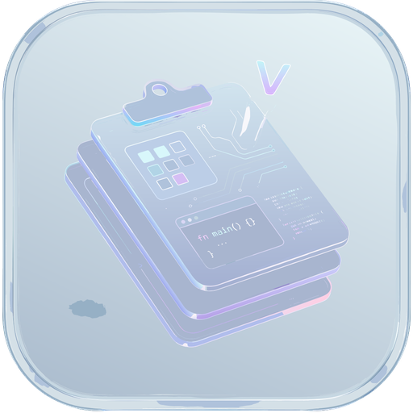

<p align="center">
  
</p>

<h1 align="center">Zlip</h1>

<p align="center">
  <b>Press <kbd>Win</kbd>+<kbd>V</kbd>. Find anything you've copied.</b><br>
  A fast, private, glass-styled clipboard manager for Windows, built with Rust and Tauri.
</p>

<p align="center">
  <a href="https://github.com/rhshourav/Zlip/actions/workflows/ci.yml"></a>
  <a href="https://github.com/rhshourav/Zlip/actions/workflows/audit.yml"></a>
  <a href="https://github.com/rhshourav/Zlip/releases"></a>
  
  
</p>

<p align="center">
  <a href="https://rhshourav.github.io/Zlip/">Website</a> ·
  <a href="https://github.com/rhshourav/Zlip/releases">Releases</a> ·
  <a href="https://github.com/rhshourav/Zlip/issues">Report an issue</a>
</p>

> **Status:** pre-release. The first installer is coming very soon. Until then, you can build Zlip from source.

---

## Why Zlip

The built-in Windows clipboard panel remembers things, but it can't search well, sort what you copied, or protect what you shouldn't have copied at all. Zlip replaces it with a panel that:

- opens instantly on `Win+V` and starts filtering the moment you type,
- sorts every clip by kind, with a pastel color per type so you spot items before you read them,
- lets you paste several items in order, reshape text before it lands, and keep snippets pinned,
- ignores password managers and wipes secrets from history automatically.

## Features

| Remember | Reshape | Automate |
|---|---|---|
| **Smart categories** for text, images, code, colors, and links | **Paste queue**: copy five things, paste five things, first in first out | **Syntax highlighting** for JSON, XML, SQL, and Rust |
| **Snippet folders** for commands, boilerplate, and signatures | **Paste formatting**: plain text, casing, trimmed whitespace, Base64 decode | **Placeholders**: `{date}`, `{clipboard_state}`, `{cursor}` |
| **Instant fuzzy search** with typo tolerance | **Quick edit** in a mini editor inside the overlay | **Action webhooks** to a local script or CI trigger |

Every shortcut, retention rule, theme color, and automation is configurable through a TOML file or the settings screen.

## Install

**With Winget** (once the first release is published):

```powershell
winget install rhshourav.Zlip
```

**With the installer:** download the `.exe` or `.msi` from the [latest release](https://github.com/rhshourav/Zlip/releases/latest).

<details>
<summary><b>Verify your download</b></summary>

Every release includes a `SHA256SUMS.txt` and a build provenance attestation. Compare the hash of your file with the published one:

```powershell
Get-FileHash .\<installer-name> -Algorithm SHA256
```

If you have the GitHub CLI, you can also check the attestation:

```powershell
gh attestation verify .\<installer-name> --repo rhshourav/Zlip
```

</details>

## Privacy and security

A clipboard sees everything you copy, so Zlip is strict by default.

- **Password managers are ignored.** Bitwarden, 1Password, and similar apps are blocklisted from the first launch.
- **Secrets expire in 60 seconds.** High-entropy strings such as API keys and card numbers are cleared automatically.
- **Memory is wiped, not just freed.** Sensitive buffers are zeroed in Rust when they are dropped.
- **Dependencies are watched.** `cargo audit` and `npm audit` gate every change, and a scheduled scan runs daily against the lockfiles.
- **Releases are verifiable.** Installers ship with SHA256 sums, a provenance attestation, and signed updater files.

## Configuration

<details>
<summary><b>Example config</b></summary>

This is an illustration of the kind of options available, not the complete schema.

```toml
[general]
hotkey = "Win+V"

[retention]
max_items = 500
secret_ttl_seconds = 60

[security]
ignore_apps = ["Bitwarden", "1Password"]

[theme]
blur = 24
```

</details>

## Project layout

```
Zlip/
├─ src-tauri/        Tauri shell, tray, overlay window
├─ zlip-core         history, categories, paste queue
├─ zlip-config       TOML schema, live reload
├─ zlip-security     blocklist, entropy check, wipe
├─ zlip-highlight    JSON / XML / SQL / Rust
├─ src/              frontend
├─ docs/             project website (GitHub Pages)
└─ .github/workflows/
   ├─ ci.yml         every push and pull request
   ├─ release.yml    tag → installers → Winget
   ├─ audit.yml      daily vulnerability scan
   └─ links.yml      site link check
```

## Build from source

You need Windows with the MSVC build tools and WebView2, Rust (stable), and Node 22.

```powershell
git clone https://github.com/rhshourav/Zlip.git
cd Zlip
npm ci
npx tauri dev          # run with hot reload
npx tauri build        # produce installers
```

The same checks CI runs:

```powershell
cargo fmt --all -- --check
cargo clippy --workspace --all-targets --all-features --locked -- -D warnings
cargo test --workspace --locked
npm run lint && npm run check && npm run build
```

## How releases work

Pushing a version tag does everything:

1. **Validate.** The tag must look like `v1.2.3` and match the versions in `Cargo.toml` and `tauri.conf.json`.
2. **CI gate.** The release reuses the same checks that run on every pull request.
3. **Build.** One run produces an NSIS `.exe` and a WiX `.msi`, then adds SHA256 sums and a provenance attestation.
4. **Publish.** A draft release holds the installers and updater signatures.
5. **Winget.** The pipeline hashes the public installer, writes the manifests, and opens a pull request on `microsoft/winget-pkgs`.

```powershell
# bump the version in Cargo.toml and tauri.conf.json, commit, then:
git tag v0.1.0
git push origin v0.1.0
```

<details>
<summary><b>Secrets the pipeline expects</b></summary>

Store these in a GitHub Environment named `release`:

| Secret | Purpose |
|---|---|
| `TAURI_SIGNING_PRIVATE_KEY` and `TAURI_SIGNING_PRIVATE_KEY_PASSWORD` | Signs updater files |
| `WINDOWS_CERTIFICATE` and `WINDOWS_CERTIFICATE_PASSWORD` | Optional Authenticode `.pfx`, base64 encoded |
| `WINGET_PKGS_TOKEN` | Classic token with `public_repo` scope, used to open the winget-pkgs PR |

</details>

## Contributing

Issues and pull requests are welcome. Please run the checks above before you open a pull request, since CI enforces formatting, `clippy -D warnings`, and the tests.

## License

[MIT](LICENSE) © [rhshourav](https://github.com/rhshourav)
